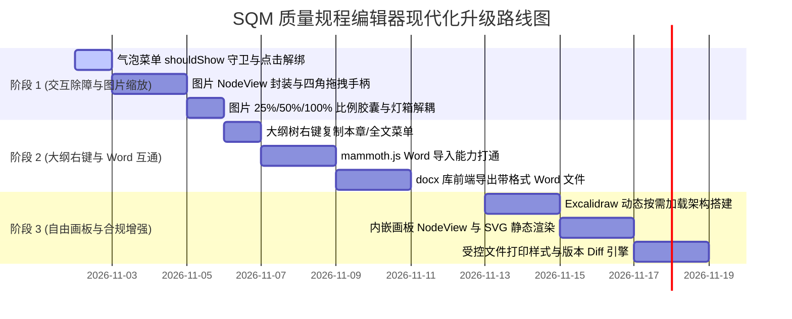

# SQM 质量规程文档编辑器：现代化飞书级体验全景开发计划

> **文档版本**：v1.2.0  
> **更新日期**：2026-11-01  
> **所属模块**：质量知识库 · 规程编辑器 (`TiptapEditor.vue`)、知识库编辑页 (`DocEditorPage.vue`)、AI 智写中心 (`DocAiCopilot.vue`)  
> **对齐目标**：消除当前阻碍日常编辑的交互缺陷，无缝对齐飞书文档、Notion 的现代化工程规程协作体验（图片自由拉伸、大纲右键剪贴板、Word 双向互通、内嵌 Excalidraw 自由画板、质量合规审计）。

---

## 一、 系统架构现状与演进目标

### 1.1 技术底座现状
* **前端框架**：Vue 3.5 + TypeScript 5.6 + Vite 8.3 + Element Plus 2.14；
* **富文本核心**：Tiptap v3.32 (`@tiptap/vue-3`, `@tiptap/starter-kit`, `@tiptap/pm`)；
* **已就绪能力**：
  * Mermaid 矢量 SVG 流程图动态渲染；
  * Mac 风格三色圆点深色终端代码块 (`CodeBlockComponent.vue` + `lowlight`)；
  * 通用三线表美化与斑马纹高亮；
  * Element Plus 图片免下载灯箱预览 (`ElImageViewer`)；
  * 左侧行标槽 Gutter（01, 02...）与右侧目录大纲树 (`outline-tree-item`)。

### 1.2 核心演进目标
```
[ 规程富文本编辑器核心 ]
   ├── 修复层 (P0 缺陷根治)
   │     ├── 解除正文点击全选劫持 ➔ 恢复 ProseMirror 原生单机打字与局部划词
   │     ├── BubbleMenu 严密守卫 ➔ 仅限主动划选纯文本浮出，失焦秒隐
   │     └── 粘贴图片可缩放 ➔ Vue NodeView 封装四角拖拽手柄 + 预设比例胶囊
   ├── 效率层 (P1 知识流转)
   │     ├── 大纲树右键菜单 ➔ 一键复制本章节 Markdown/富文本、复制全文
   │     ├── Word 导出 ➔ docx 库无损将 H1~H3、三线表、代码块导出为 .docx
   │     └── Word 导入 ➔ mammoth.js 拖入解析 Word 无损灌入规程正文
   └── 制造级协同层 (P2 飞书级增强)
         ├── 内嵌自由画板 ➔ Excalidraw (85k★) 矢量白板，工艺拓扑/缺陷红笔圈注
         ├── 规程版本对比 ➔ 版本快照 Git 式左右分栏红绿 Diff
         └── 合规受控打印 ➔ ISO 9001 / IATF 16949 受控标识 PDF 导出
```

---

## 二、 详细任务拆解与技术方案

### 阶段 1：P0 级核心交互修复与图片等比缩放

#### 任务 1.1：气泡菜单常驻遮挡问题彻底根治
* **问题定位**：
  * [TiptapEditor.vue:895](file:///d:/AIAPP/Tars/frontend/src/components/editor/TiptapEditor.vue#L895) 中 `@click="handleContentClick"` 在用户单机正文任意位置时直接调用了 `handleBlockSelect(block)`，强制触发了全段 `setTextSelection`；
  * `<bubble-menu>` 缺少严格的 `:should-show` 判定函数，导致每次点进正文都被判定为“文本全选”，弹出悬浮栏死死挡在正文上方。
* **技术方案**：
  1. **解绑正文默认点击劫持**：将信标圈选限制在左侧 Gutter 行标槽或按住 `Ctrl/Shift` 点击时触发，正文单机恢复原生光标插入；
  2. **增加严格守卫函数 `shouldShowBubbleMenu`**：
     ```typescript
     const shouldShowBubbleMenu = ({ editor, view, state, from, to }: any) => {
       if (!editor || !editor.isEditable || !view.hasFocus()) return false
       if (state.selection.empty || from === to) return false
       // 排除已拥有独立操作栏的复杂节点
       if (editor.isActive('codeBlock') || editor.isActive('image') || editor.isActive('table')) {
         return false
       }
       const text = state.doc.textBetween(from, to).trim()
       return text.length > 0
     }
     ```
  3. **生命周期与定位重校**：确保编辑器失焦或按下 `Esc` 键时悬浮菜单自动隐藏。

#### 任务 1.2：粘贴图片自由拖拽缩放与预设比例（飞书级）
* **技术方案**：
  1. **Schema 属性扩展**：
     使用 `Image.extend` 声明 `width`, `height`, `align` 属性，支持持久化存储到 HTML 属性中；
  2. **封装 `ResizableImageComponent.vue`（NodeView）**：
     * 选中状态显示微发光轮廓；
     * 四角提供蓝色拉伸把手（Handle），按住鼠标拖拽实时等比计算并更新宽百分比或像素；
     * 浮现悬浮尺寸控制工具条：
       * `25%` | `50%` | `75%` | `100%` | `适应宽度`；
       * 居左 / 居中 / 居右 对齐切换；
       * 🔍 全屏免下载灯箱预览图标（彻底分离常规调整尺寸与全屏看大图的交互）。

---

### 阶段 2：P1 级大纲右键复制与 Word 双向互通

#### 任务 2.1：大纲树右键上下文菜单 (`DocOutlineContextMenu.vue`)
* **技术方案**：
  1. 在大纲树项 `outline-tree-item` 上绑定 `@contextmenu.prevent="handleOutlineContextMenu($event, h)"`；
  2. 弹出轻量悬浮菜单，提供：
     * **📋 复制本章节 Markdown**：调用 Tiptap 提取 `[h.pos, h.endPos)` 区间文本并转为 Markdown 存入剪贴板；
     * **📑 复制本章节带格式文本**：直接提取对应 DOM 片段灌入 `navigator.clipboard.write`；
     * **📄 一键复制全篇规程**；
     * **✨ 以本章节为靶向呼出 AI**：自动填充当前章节上下文，呼出 AI 智写。

#### 任务 2.2：Word 导入（Word .docx ➔ 富文本）
* **依赖引入**：`mammoth`（纯前端轻量 MIT 库，约 100KB）；
* **技术方案**：
  1. 工具栏增加 `[ 📤 导入 Word ]` 图标按钮；
  2. 支持点击弹窗上传或直接向编辑器拖入 `.docx` 文件；
  3. 通过 `mammoth.convertToHtml` 将 Word 的 Heading 1/2/3、三线表、加粗、有序/无序列表转换为标准 HTML；
  4. 一键回填到编辑器中，自动更新左侧行标与右侧大纲树。

#### 任务 2.3：Word 导出（规程文档 ➔ 规范 .docx 文件）
* **依赖引入**：`docx` 库（纯前端浏览器直接打包生成 Word 格式，无需后端依赖）；
* **技术方案**：
  1. 工具栏增加 `[ 📥 导出 Word ]` 按钮；
  2. 解析编辑器当前的 ProseMirror JSON 树，映射生成 Word 文档结构：
     * 规程标题 ➔ Document Title；
     * H1/H2/H3 ➔ Heading 1/2/3 样式，并自动生成 Word 内置目录大纲；
     * 三线表格 ➔ 带边框与灰色表头的标准 Word Table；
     * 图片 ➔ 内嵌 Base64/Blob 矢量图片；
     * 代码块 ➔ 浅灰背景底纹的等宽文本段落；
  3. 触发浏览器直接另存为 `[规程名称]_v1.0.docx`。

---

### 阶段 3：P2 级 Excalidraw 自由画板与质量体系合规

#### 任务 3.1：自由化内嵌画板（对齐飞书画板）
* **开源选型**：首选 **Excalidraw**（8.5万+ Stars，完全免费，MIT 协议，自带手绘/工程矢量双模式）；
* **架构设计**：
  1. **按需异步加载**：通过 Vite 代码分割（Code-Splitting）按需动态引入，避免污染主包体积；
  2. **封装 `WhiteboardNodeView.vue`**：
     * **文档展示态**：静态轻量渲染高质量 SVG 矢量图，内存占用极小，打印与转 Word 完美兼容；
     * **编辑态**：双击或点击工具条“编辑画布”，全屏/弹窗呼出 Excalidraw 工作台；
     * **保存机制**：编辑完成点击“确定应用”，将画布元素 JSON 与渲染导出的 SVG 共同存入节点属性中，自动同步后端保存。

#### 任务 3.2：质量体系合规受控打印与版本 Diff
* **受控文件打印**：
  * 配置 `@media print` 专用打印版式；
  * 自动注入制造业受控标头（受控编号、编制人、审核人、批准人、版本号、生效日期），隐藏交互工具条；
* **版本快照 Diff**：
  * 在保存同步时生成快照，允许按时间点对比两个版本的规程差异，以绿色标注新增、红色标注删除。

---

## 三、 实施路线图 (Roadmap & Timeline)



---

## 四、 验收指标 (Acceptance Criteria)

| 模块 | 验收标准 | 验证手段 |
| :--- | :--- | :--- |
| **气泡菜单** | 在正文任意位置单击打字，菜单**绝对不弹出**；仅用鼠标主动选中文本时弹出，失焦立即消失 | 页面全流程鼠标操作测试 |
| **图片缩放** | 点击图片出现 4 个可拖拽蓝点手柄，拖拽可等比拉伸；点击 50% 按钮宽度立即为 50%；点击灯箱图标正常全屏预览 | 粘贴截图并缩放验证 |
| **大纲右键** | 右键点击二级章节，弹出菜单选择“复制本章”，粘贴出来的纯文本/Markdown 恰好为该章节下的所有段落 | 剪贴板提取与比对 |
| **Word 导入/导出** | 上传带有表格与标题的 `.docx`，正文准确呈现对应标题与表格；点击导出 Word，生成的 `.docx` 本地能正常打开且格式对齐 | 真实规程 Word 文件互导验收 |
| **自由画板** | 点击“插入画板”，可手绘流程箭头与零件拓扑，保存后正文内嵌矢量图，刷新页面内容不丢失 | Excalidraw 画布持久化验证 |
