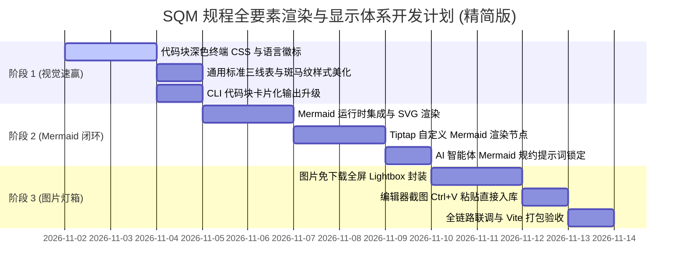

# SQM 质量规程全要素渲染与显示体系：开发计划 (精简聚焦版)

> **文档版本**：v1.1.0 (精简版)  
> **更新日期**：2026-11-01  
> **变更说明**：**彻底剔除专有 CTQ 公差表格开发**，聚焦于通用标准三线表格美化，全面专注解决 **Mermaid 矢量图、深色语法高亮代码块、图片免下载灯箱预览、通用数据表格** 四大真实核心诉求。  
> **所属模块**：质量知识库 · 规程编辑器 (`TiptapEditor.vue`) & AI 智写中心 (`DocAiCopilot.vue`)  

---

## 目录
1. [聚焦目标与范围界定 (排除过度设计)](#一-聚焦目标与范围界定-排除过度设计)
2. [五大核心模块详细开发任务](#二-五大核心模块详细开发任务)
3. [三阶段敏捷实施路线图 (Roadmap)](#三-三阶段敏捷实施路线图-roadmap)
4. [验收标准](#四-验收标准)

---

## 一、 聚焦目标与范围界定 (排除过度设计)

### 1.1 明确边界：不做 CTQ 专有公差表格
* **不开发**：CTQ 尺寸公差上下限 (USL/LSL) 胶囊计算、抽样超差红线告警等复杂专用逻辑（留待后续独立质量特性模块专门立项）；
* **只保留**：**通用标准三线表格（Clean Modern Table）**。用于展示数据库字典表（字段/类型/说明）、任务责任表、清单对比表，仅需具备清爽表头、细边框与斑马纹，保持纯粹与轻量。

### 1.2 四大真实核心诉求
1. **Mermaid 矢量流程图**：彻底替代【信标 1】丑陋易撕裂的 `+---+` ASCII 字符画，原生输出高清 SVG 流程图与时序图；
2. **深色终端级代码块**：彻底解决【信标 2】白底单色黑字裸奔问题，提供 Mac 风格顶栏、语法高亮与一键复制；
3. **通用标准三线表**：清爽微渐变表头、奇偶斑马纹、悬停高亮，用于规程中数据字典与任务列表排版；
4. **图片附件免下载直开 (Lightbox)**：规程中的截图与图纸点击直接弹出全屏灯箱查看，支持滚轮缩放，免去先下载到本地桌面的繁琐步骤。

---

## 二、 五大核心模块详细开发任务

### 模块 1：代码块现代化深色终端容器（解决信标 2 裸奔）
- [ ] **集成轻量语法高亮**：
  - 在 `TiptapEditor.vue` 中配置 `CodeBlockLowlight`，预设 `sql`, `typescript`, `python`, `json`, `bash` 常用语言；
- [ ] **Mac 风格终端顶栏**：
  - 代码块顶部渲染控制栏：左侧 Mac 三色小圆点（红 `#ef4444`、黄 `#f59e0b`、绿 `#10b981`）；
  - 居中/右侧显示当前语言徽标（如 `SQL`、`JSON`）；
  - 右上角提供 `[ 📋 复制代码 ]` 按钮，点击调用剪贴板并提示“已复制”；
- [ ] **深色终端主题样式**：
  - 背景色：`#0f172a`（Slate 900），字体：`JetBrains Mono, Consolas, monospace`；
  - 语法着色：关键字（天蓝 `#38bdf8`）、字符串（嫩绿 `#4ade80`）、注释（冷灰 `#64748b`）、数值（金黄 `#fbbf24`）。

### 模块 2：Mermaid 矢量流程图引擎（解决信标 1 字符画）
- [ ] **运行时集成**：
  - 复用项目既有的 `test/mermaid.min.js`，初始化工业通用配色主题（节点主色 `#2563eb`，边框 `#93c5fd`）；
- [ ] **Tiptap 自定义 Mermaid 节点**：
  - **展示态**：将 ````mermaid```` 自动动态渲染为高清 SVG 矢量流程图，支持居中排版；
  - **编辑态**：双击或点击源码按钮可查看并修改 Mermaid 代码；
- [ ] **语法容错保护**：
  - 语法错误时不中断页面渲染，友好展示错误提示并高亮问题行。

### 模块 3：通用标准三线表（极简高信噪比排版）
- [ ] **基础美化样式**：
  - 表头采用浅灰渐变底色（`#f8fafc` ➔ `#f1f5f9`），文字加粗（`#0f172a`）；
  - 奇偶行斑马纹交替底色（`#ffffff` / `#f8fafc`），鼠标悬停整行浅蓝高亮；
  - 边框采用淡雅灰（`#e2e8f0`），彻底摒弃厚重黑线；
- [ ] **通用数据结构呈现**：
  - 完美适配 AI 生成的“数据库表字典结构”和“任务清单表”。

### 模块 4：图片免下载全屏灯箱 (Lightbox)
- [ ] **截图直接粘贴**：
  - 规程编辑器支持剪贴板图片 `Ctrl+V` 粘贴直接入库呈现；
- [ ] **全屏灯箱直开**：
  - 正文中的任何图片点击后居中弹出半透明全屏遮罩；
  - 支持鼠标滚轮平滑缩放（10% ~ 500%）、按住拖拽平移、双击重置。

### 模块 5：CLI 转换器与 AI 提示词规约
- [ ] **CLI 工具智能拦截 (`cli/sync_copilot.py`)**：
  - 遇到 ````mermaid```` 代码块时，包装为带有标记的图表容器；
  - 遇到代码块时，输出带有顶栏与语言徽标的卡片结构；
- [ ] **AI 智能体提示词规范锁定**：
  - System Prompt 明确指令：**“严禁使用 +---+ 等字符画输出架构图，必须输出标准 Mermaid 代码块”**；
  - 明确指令：**“输出数据库字段或任务列表时，统一使用标准 Markdown 管道表格”**。

---

## 三、 三阶段敏捷实施路线图 (Roadmap)



---

## 四、 验收标准

1. **信标 1 彻底解决**：架构图 100% 呈现为清晰的 Mermaid SVG 矢量图，不再出现任何脆弱易变形的 `+---+` 字符框图；
2. **信标 2 彻底解决**：SQL DDL 或代码块全部具备深色终端质感（Slate-900）、Mac 圆点、语言标签与一键复制代码按钮；
3. **表格清爽通用**：数据字典与任务列表以现代三线表排版，清爽无杂音；
4. **图片免下载秒开**：点击正文图片直接全屏高清弹窗放大查看；
5. **轻量稳定**：Vite 打包时间保持在 2 秒以内，0 报错。
