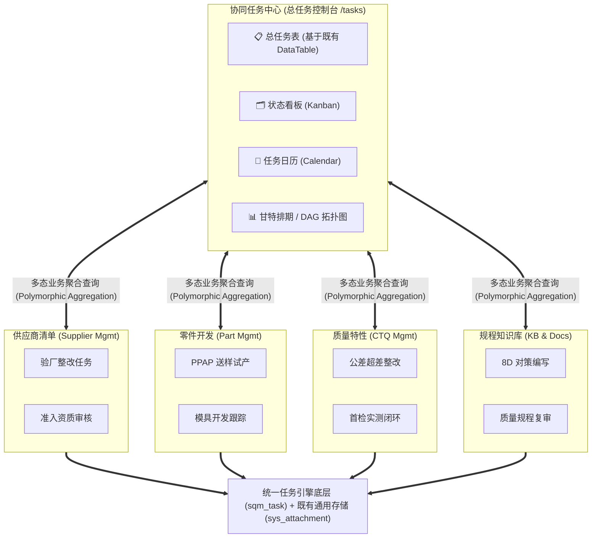
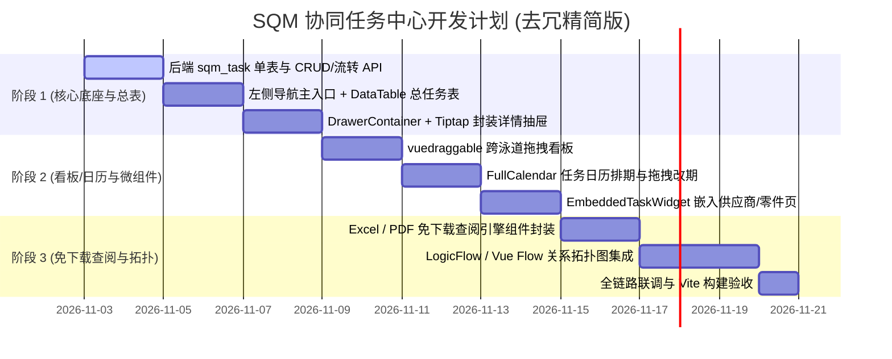

# SQM 协同任务中心：架构目标、系统设计与开发计划 (去冗精简·高效复用版)

> **文档版本**：v2.0.0 (精简版)  
> **更新时间**：2026-11-01  
> **核心原则**：**严禁重复造轮子**。深度复用平台既有的 Tiptap 富文本体系、`sys_attachment` 通用附件池、`DataTable` 复合总表与 `DrawerContainer` 抽屉，研发重心 100% 聚焦于“多业务源头融合、看板与日历多维排期、DAG 依赖拓扑图、业务页面插拔微组件”。  
> **所属模块**：左侧导航栏一级主业务模块 · 协同任务中心 (`/tasks`)

---

## 目录
1. [系统定位与资产复用排雷矩阵](#一-系统定位与资产复用排雷矩阵)
2. [总体架构与业务源头融合模式](#二-总体架构与业务源头融合模式)
3. [数据库模型与元数据设计 (去重版)](#三-数据库模型与元数据设计-去重版)
4. [附件体系与“免下载直开”预览设计 (基于既有资产)](#四-附件体系与免下载直开预览设计-基于既有资产)
5. [四大核心视图与开源技术选型](#五-四大核心视图与开源技术选型)
6. [详细功能清单 (Feature Breakdown)](#六-详细功能清单-feature-breakdown)
7. [敏捷迭代开发计划 (Roadmap)](#七-敏捷迭代开发计划-roadmap)
8. [验收标准与风险控制](#八-验收标准与风险控制)

---

## 一、 系统定位与资产复用排雷矩阵

### 1.1 核心痛点与定位
在 SQM 制造业系统中，供应商审核整改、零件开模试产（PPAP）、CTQ 尺寸公差超差、8D 质量遏制等业务分散，存在任务孤岛、附件必须下载到本地查看、缺乏前后置工序阻断拓扑链等痛点。  
**系统定位**：构建轻量、敏捷、可插拔的任务协同中枢。它既是主导航的**全局总任务控制台**，又是可无缝嵌入各业务详情页的**可插拔微组件**。

### 1.2 平台已有资产 100% 复用与去重决策 (拒绝重复造轮子)

| 业务域 | 原计划（重复造轮子） | 平台既有成熟资产 | 极简复用决策 |
| :--- | :--- | :--- | :--- |
| **富文本与任务清单** | 另建一套 Markdown/富文本编辑器与 Checklist | 平台已拥有高度定制的 `TiptapEditor.vue`（支持 TaskList 任务清单勾选、三线表、深色终端代码、图片灯箱） | **100% 复用 Tiptap**：任务描述与验收 Checklist 直接以 `:readonly="true/false"` 模式嵌入 Tiptap，零多余第三方包。 |
| **Word 在线预览** | 额外引入数十兆臃肿的 `@vue-office/docx` | 平台已安装 `mammoth` 并在 `wordHelper.ts` 中打通了 Word ➔ HTML 解析 | **100% 复用 mammoth + Tiptap**：用户查阅 `.docx` 附件时，直接由 `mammoth` 无损转为 HTML 在只读 Tiptap 抽屉中查看，样式与全站完美融合。 |
| **附件与文件存储** | 重新建表 `sqm_task_attachment` 并重写上传流 | 后端已有通用 `sys_attachment` 表（自带 `biz_type/biz_id`）；`r_storage.py` 已有完整的动态流式分片上传接口 | **彻底放弃新建附件关联表**：任务附件统一走 `sys_attachment`，传入 `biz_type="task"`, `biz_id=task.id`，存储与下载全套现成接口直接调用！ |
| **数据总表 (Grid)** | 从零手写搜索、分页、排序、空状态、骨架屏 | 前端已有通用高可配的 `components/common/DataTable` | **直接基于 `DataTable` 配置列属性**：仅需写 30 行配置即可获得生产级总表，开发量缩减 80%。 |
| **任务侧拉抽屉** | 从零手写遮罩、抽屉容器、滚动区域 | 前端已有通用 `components/common/DrawerContainer.vue` | **直接基于 `DrawerContainer` 包装**，视觉统一，自带优雅进出场动效。 |
| **图片附件预览** | 重新封装大图弹窗 | `TiptapEditor.vue` 与 Element Plus `el-image-viewer` 已就绪 | **直接触发既有 Lightbox**，支持滚轮缩放、1:1 像素复位、翻转。 |

---

## 二、 总体架构与业务源头融合模式



### 2.1 多态业务源头挂钩
* **源头类型 (`source_type`)**：
  * `SUPPLIER`：供应商模块发起的任务（如：年度审核不合格项整改）；
  * `PART`：零件开发发起的任务（如：首件检验 FAI 提交、Cpk 评估报告）；
  * `CTQ`：关键质量特性抽样超差整改任务；
  * `DOC_KB`：质量知识库/标准文档的评审与复核；
  * `CUSTOM`：用户在总任务中心自行创建的普通质量待办。
* **源头穿透 (`source_id` & `source_title` & `source_url`)**：
  在任务表中一键点击源头徽标，平滑穿透回原业务详情页。

---

## 三、 数据库模型与元数据设计 (去重版)

### 3.1 核心任务表：`sqm_task` (仅需一张纯粹高效的任务表)
```sql
CREATE TABLE sqm_task (
    id SERIAL PRIMARY KEY,
    task_code VARCHAR(32) UNIQUE NOT NULL,       -- 任务编号，如 TSK-202611-001
    title VARCHAR(255) NOT NULL,                 -- 任务标题
    description_html TEXT,                       -- 任务要求/验收Checklist (HTML/富文本)
    
    -- 状态流转与优先级
    status VARCHAR(32) NOT NULL DEFAULT 'TODO',  -- TODO(待办), IN_PROGRESS(进行中), PENDING_REVIEW(待验收), DONE(已闭环), BLOCKED(阻塞)
    priority VARCHAR(16) NOT NULL DEFAULT 'M',   -- LOW, MEDIUM, HIGH, URGENT (红线)
    
    -- 多态业务源头挂钩
    source_type VARCHAR(32) NOT NULL,            -- SUPPLIER, PART, CTQ, DOC_KB, CUSTOM
    source_id INT,                               -- 关联业务的主键 ID (如 supplier_id)
    source_title VARCHAR(255),                   -- 源头名称快照 (如 "苏州某某精工有限公司")
    source_url VARCHAR(255),                     -- 快捷回跳路由 (如 "/maindata/supplier")
    
    -- 人员与排期
    assignee_id INT,                             -- 责任人 ID
    assignee_name VARCHAR(64),                   -- 责任人姓名
    creator_id INT,                              -- 创建人 ID
    creator_name VARCHAR(64),                    -- 创建人姓名
    start_date DATE,                             -- 计划开始日期
    due_date DATE,                               -- 计划截止日期
    completed_at TIMESTAMP,                      -- 实际完成时间
    
    -- 流程依赖 (DAG 拓扑)
    parent_id INT REFERENCES sqm_task(id),       -- 父任务 ID (支持拆解子任务)
    predecessor_ids JSONB DEFAULT '[]',          -- 前置依赖任务 ID 数组，如 [101, 102]
    
    -- 排序与元数据
    sort_order INT DEFAULT 0,
    tags JSONB DEFAULT '[]',                     -- 标签池，如 ["8D遏制", "注塑试模", "CTQ红线"]
    created_at TIMESTAMP DEFAULT CURRENT_TIMESTAMP,
    updated_at TIMESTAMP DEFAULT CURRENT_TIMESTAMP
);

CREATE INDEX idx_sqm_task_status ON sqm_task(status);
CREATE INDEX idx_sqm_task_source ON sqm_task(source_type, source_id);
CREATE INDEX idx_sqm_task_assignee ON sqm_task(assignee_id);
CREATE INDEX idx_sqm_task_due_date ON sqm_task(due_date);
```

### 3.2 任务附件直接挂接既有表：`sys_attachment` (零新增表)
直接复用平台现有的 `sys_attachment`：
* 存储任务附件时：`biz_type = 'task'`，`biz_id = task.id`；
* 查询任务附件时：直接查询 `/api/storage/list?biz_type=task&biz_id={task_id}`；
* 上传任务附件时：直接调用已有的通用上传接口 `/api/storage/upload`。

---

## 四、 附件体系与“免下载直开”预览设计 (基于既有资产)

| 文件类型 | 选用轻量渲染引擎 | 架构设计与复用逻辑 |
| :--- | :--- | :--- |
| **Word 规程 / 8D 报告 (.docx)** | **平台既有 `mammoth` + `TiptapEditor`** | **100% 复用**。不引第三方庞大 Office 预览包，调用 `mammoth.convertToHtml` 直接在只读 Tiptap 抽屉中原汁原味排版展示。 |
| **质检缺陷图片 (.jpg/.png/.webp)** | **平台既有 `ElImageViewer`** | **100% 复用**。点击图片调用已打通的 `sqm-image-lightbox` 触发免下载全屏灯箱，支持平滑缩放与细节核对。 |
| **Excel 尺寸表 / Cpk 记录 (.xlsx)** | **`@vue-office/excel`** | 仅按需引入该轻量 Canvas 渲染器，支持多 Sheet 标签切换、公差高亮、冻结表头与网格排版。 |
| **PDF 检测报告 / 图纸 (.pdf)** | **`vue-pdf-embed` / 内置 Object** | 纯前端渲染，支持多页连续滚动、缩放与就地打印。 |
| **代码 / 文本 / Log** | **平台既有深色终端样式** | 使用深色卡片与等宽字体直接就地排版。 |

---

## 五、 四大核心视图与开源技术选型

```
[ 协同任务中心四大视图矩阵 ]
   ├── 1. 总表模式 (Grid) ➔ 100% 复用既有 DataTable 组件 (按源头/状态/到期日极速过滤)
   ├── 2. 状态看板 (Kanban) ➔ vuedraggable-es (4 列泳道跨列平滑拖拽改变状态机)
   ├── 3. 任务日历 (Calendar) ➔ @fullcalendar/vue3 (月/周日历格拖拽快速改期)
   └── 4. 依赖拓扑图 (Workflow DAG) ➔ LogicFlow / Vue Flow (直观展现工序前后置阻断红线)
```

| 视图类型 | 适用业务场景 | 技术选型 | 优势与选型理由 |
| :--- | :--- | :--- | :--- |
| **1. 总任务表 (Grid)** | 全厂质量待办汇总、批量改派责任人、批量调整截止日期 | **复用 `components/common/DataTable`** | 现成搜索、插槽、分页、排序联动，开箱即用 |
| **2. 状态泳道看板** | 敏捷质量攻关（待办 ➔ 跟进中 ➔ 待复核 ➔ 已闭环） | **`vuedraggable-es`** (Sortable.js) | 轻量极简，支持跨泳道拖拽排序并实时更新任务 `status` |
| **3. 任务日历排期** | 工程师月度/周度检验排期、巡检日历 | **`@fullcalendar/vue3`** | 行业标杆（18k★），支持月历/周视图，拖拽即改期 |
| **4. 流程依赖拓扑图** | 供应商开模延期 ➔ 试产阻断 ➔ 首检推迟流向链 | **`LogicFlow` (滴滴开源) 或 `Vue Flow`** | 节点注入状态卡片，连线支持虚线动画与阻塞红线 |

---

## 六、 详细功能清单 (Feature Breakdown)

### 6.1 模块 1：左侧导航入口与总任务控制台 (`views/task/TaskCenter.vue`)
- [ ] 在 `src/layout/LeftSidebar.vue` 中新增顶级菜单项：`📋 协同任务中心`；
- [ ] 注册主路由 `/tasks`，支持 4 个二级 Tab 切换（总表、看板、日历、DAG 拓扑）；
- [ ] 顶部多维筛选条：
  - 业务源头切片（全部 / 供应商 / 零件 / CTQ / 规程）；
  - 任务状态（全部 / 待办 / 进行中 / 待验收 / 已闭环 / 已阻塞）；
  - 紧急度（普通 / 重点关注 / CTQ 紧急红线）；
  - 到期预警（今日待办 / 本周到期 / 已经超期）；
- [ ] **总表视图**：配置现有 `DataTable` 列属性（任务编码、标题、业务源头徽标、责任人、起止日期、状态胶囊、一键直达原业务按钮）。

### 6.2 模块 2：任务详情侧拉抽屉 (`TaskDetailDrawer.vue`)
- [ ] 外层基于现有 `DrawerContainer.vue` 组装；
- [ ] 标题与描述：内嵌紧凑版 `TiptapEditor.vue`，支持任务验收 Checklist 勾选与表格排版；
- [ ] 责任人选择与日期排期选择器；
- [ ] 业务源头快照卡片（供应商名/零件号/CTQ点，点击新标签页直达）；
- [ ] 附件管理：直接复用已有 `uploader` 组件，直接挂载 `sys_attachment`。

### 6.3 模块 3：跨泳道拖拽看板 (Kanban)
- [ ] 4 大核心泳道：`待办任务 (TODO)`、`进行中 (IN_PROGRESS)`、`待复核验收 (PENDING_REVIEW)`、`已闭环 (DONE)`；
- [ ] 卡片展示：任务编号、业务源头小徽标、优先级红标、截止日期、责任人头像；
- [ ] 拖拽交互：使用 `vuedraggable-es` 拖拽卡片跨列释放，自动调用状态更新 API。

### 6.4 模块 4：FullCalendar 任务日历视图
- [ ] 集成 `@fullcalendar/vue3`；
- [ ] 将带截止日期的任务渲染在月日历/周日程格中；
- [ ] 支持在日历上直接拖动事件块调整 `due_date`，实时与后端同步。

### 6.5 模块 5：流程关系拓扑图 (Workflow DAG)
- [ ] 集成 `LogicFlow` 或 `Vue Flow`；
- [ ] 根据任务的 `predecessor_ids` 自动计算前后置拓扑连线；
- [ ] 连线语义：若前置任务未完成（`status !== 'DONE'`），后置任务连线标红并提示“等待前置任务交付”。

### 6.6 模块 6：可插拔业务嵌入微组件 (`EmbeddedTaskWidget.vue`)
- [ ] 封装为轻量卡片组件，直接嵌入到：
  - `SupplierList` / 供应商详情抽屉（展示该供应商待办与整改单）；
  - `PartList` / 零件详情页（展示 PPAP 送样与开模任务）；
  - `CTQList` / 质量特性抽样异常处置页；
- [ ] 组件内自带“新建此业务任务”按钮，自动绑定当前 `source_type` 与 `source_id`。

---

## 七、 敏捷迭代开发计划 (Roadmap)

由于资产复用率达 60%，工期大幅压缩：



### 阶段一：核心底座、总表与详情抽屉（MVP 可用）
- **交付目标**：实现全业务源头任务的总表汇聚与基于现有 Tiptap 的详情管理。
- **产出物**：
  1. 后端 `sqm_task` 模型与 `/api/tasks` 接口；
  2. 左侧导航栏增加 `📋 协同任务中心`，配置 `DataTable` 总任务表格；
  3. 基于 `DrawerContainer` + `TiptapEditor` + `sys_attachment` 交付任务详情侧拉抽屉。

### 阶段二：状态看板、任务日历与插拔微组件（排期可视化）
- **交付目标**：打破纯表格单调形态，交付敏捷拖拽看板与时间日历，并打通业务源头闭环。
- **产出物**：
  1. 状态泳道看板（拖拽变更状态）；
  2. FullCalendar 任务日历（拖拽改期）；
  3. 交付 `EmbeddedTaskWidget`，在供应商和零件详情内嵌入任务列表。

### 阶段三：Excel/PDF 免下载直开与流程依赖拓扑图（高信噪比工程）
- **交付目标**：打通尺寸表就地查阅与前后置工序阻断关系图。
- **产出物**：
  1. `@vue-office/excel` 尺寸公差表免下载查阅弹层；
  2. 基于 `LogicFlow` 或 `Vue Flow` 的前置任务 DAG 拓扑连线与阻塞红线。

---

## 八、 验收标准与风险控制

### 8.1 验收标准 (Acceptance Criteria)
1. **多态穿透**：总表中能统一筛选“供应商整改”与“零件开模”等各源头任务，点击源头标签 1 秒直跳原业务详情；
2. **零冗余开箱**：任务描述能直接使用 Checklist 任务勾选框，附件直接使用平台既有 `sys_attachment`，无冗余表；
3. **免下载秒开**：点击任务中的 Word/图片附件，直接在抽屉内无损呈现，点击 Excel 弹出 Canvas 网格，无需触发本地下载；
4. **排期一致**：在看板中拖拽任务至“已完成”，日历与总表视图状态与进度实时同步。

### 8.2 风险控制
- **DAG 拓扑环路死锁**：后端在保存 `predecessor_ids` 前置依赖时执行拓扑排序环路检测，杜绝 A 依赖 B、B 又依赖 A 的死锁逻辑；
- **大文件 Excel 渲染内存占用**：超过 20MB 的 Excel 提示“建议下载原件”，常规尺寸表秒级 Canvas 渲染。
